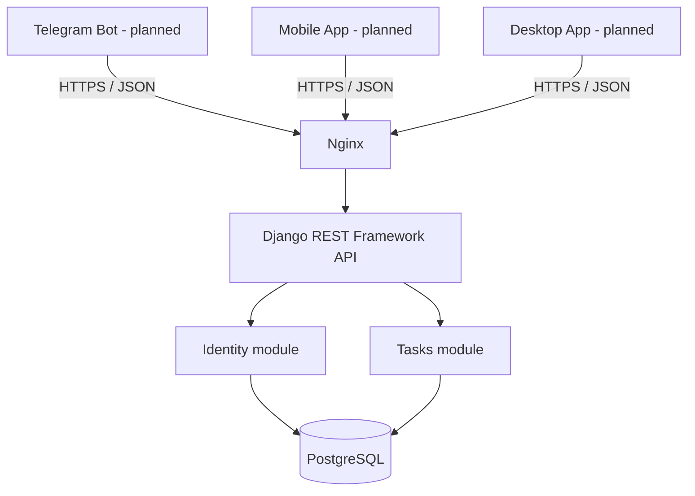

# Architecture Overview

**Status:** Proposed for Phase 1  
**Last reviewed:** 2026-10-14

## 1. Product goal

Tik be Tik is a task-management product designed to let a user manage the same tasks through multiple clients. Planned clients include:

- Telegram bot
- Mobile application
- Desktop application
- Potential future clients, provided they use the public backend API

The clients must not maintain separate copies of task business rules or independent sources of truth. The backend owns authentication, authorization, validation, and task state.

## 2. Architecture decision

The initial backend uses a **Modular Monolith** built with Django and Django REST Framework (DRF). The application runs as one deployable backend, while its domain responsibilities are separated into modules with explicit boundaries.

The initial infrastructure is intentionally small:

- Django + DRF for the application and API
- PostgreSQL as the persistent relational database
- Gunicorn as the WSGI application server in containerized deployment
- Nginx as the HTTP reverse proxy and, where appropriate, the static/media file server
- Docker Compose for local multi-container development and the learning deployment

Redis, Celery, a message broker, Kubernetes, and separate microservices are out of scope until a measurable requirement justifies them.

## 3. Logical request flow

This is a logical target diagram, not a claim that all clients or deployment components are already implemented.

## 4. Core principles

1. **One source of truth:** PostgreSQL stores the canonical user and task data.
2. **API-first:** all first-party clients interact with the backend through documented HTTP APIs, not direct database access.
3. **Client independence:** business rules must not depend on Telegram, mobile, or desktop UI code.
4. **Explicit module ownership:** a module owns its domain rules and models; cross-module dependencies are intentional and limited.
5. **Secure by default:** authorization is enforced by the backend for every user-owned resource. A client-provided user ID is never treated as proof of identity.
6. **Incremental complexity:** add infrastructure only when it solves an observed problem.
7. **Versioned contracts:** public endpoints live under `/api/v1/` so future compatible and breaking changes can be managed deliberately.

## 5. Phase 1 scope

Phase 1 includes:

- A custom user model configured before the first database migration
- The initial Tasks module and CRUD API
- Authentication and authorization foundations
- A database-backed readiness check
- Automated tests for critical model, service, and API behavior
- Docker, Compose, Gunicorn, Nginx, static/media handling, and GitHub release work as the course progresses

Phase 1 does not include a working Telegram bot, mobile app, or desktop app.

## 6. Quality gates

Before a phase is considered complete:

- The code starts from documented setup instructions.
- Tests and Django system checks pass.
- No secrets or local environment files are committed.
- Important behavior and architecture decisions are documented.
- The change is committed using a clear Conventional Commit message.
